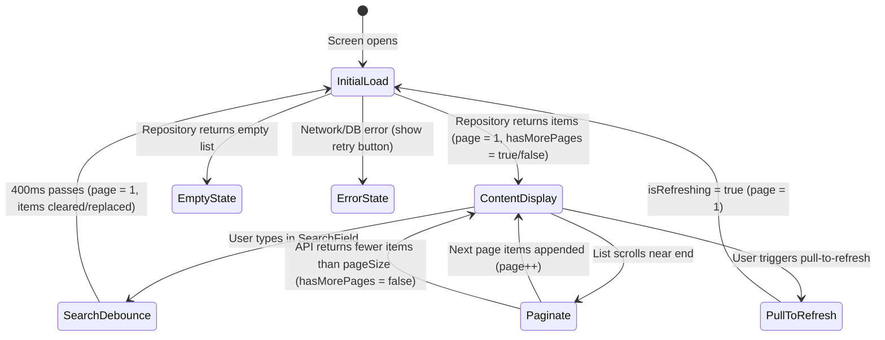

# Reference 12 — List, Search, Filter & Pagination Patterns

## Table of Contents
- [Canonical List Lifecycle](#canonical-list-lifecycle)
- [Implementation Standards](#implementation-standards)
  - [1. Presentation Layer (LazyColumn, Stable Keys, Pull-to-Refresh)](#1-presentation-layer-lazycolumn-stable-keys-pull-to-refresh)
  - [2. ViewModel Layer (StateFlow & Coroutine Handler)](#2-viewmodel-layer-stateflow--coroutine-handler)
  - [3. Search Debouncing Pattern](#3-search-debouncing-pattern)
- [Canonical File Map](#canonical-file-map)

---

## Canonical List Lifecycle

The standard pattern for paginated, searchable, and filterable feeds in Jetpack Compose:



---

## Implementation Standards

### 1. Presentation Layer (LazyColumn, Stable Keys, Pull-to-Refresh)

```kotlin
@OptIn(ExperimentalMaterial3Api::class)
@Composable
fun ItemListScreen(
    state: ItemListUiState,
    onRefresh: () -> Unit,
    onLoadMore: () -> Unit,
    onItemClick: (String) -> Unit,
    onRetry: () -> Unit,
    modifier: Modifier = Modifier
) {
    val listState = rememberLazyListState()

    // Detect when user scrolls near the end of the list (e.g. 3 items from bottom)
    val shouldLoadMore by remember {
        derivedStateOf {
            val totalItems = listState.layoutInfo.totalItemsCount
            val lastVisibleIndex = listState.layoutInfo.visibleItemsInfo.lastOrNull()?.index ?: 0
            totalItems > 0 && lastVisibleIndex >= (totalItems - 3)
        }
    }

    LaunchedEffect(shouldLoadMore) {
        if (shouldLoadMore && state.hasMorePages && !state.isPaginating && !state.isLoading) {
            onLoadMore()
        }
    }

    PullToRefreshBox(
        isRefreshing = state.isRefreshing,
        onRefresh = onRefresh,
        modifier = modifier.fillMaxSize()
    ) {
        when {
            state.isLoading && state.items.isEmpty() -> {
                // Skeleton shimmer loading placeholder
                ItemShimmerLoading(modifier = Modifier.fillMaxSize())
            }
            state.error != null && state.items.isEmpty() -> {
                // Error state with retry
                ErrorStateView(
                    message = state.error,
                    onRetry = onRetry,
                    modifier = Modifier.fillMaxSize()
                )
            }
            state.items.isEmpty() -> {
                // Empty state
                EmptyStateView(
                    title = stringResource(R.string.msg_no_results),
                    description = stringResource(R.string.msg_empty_list),
                    modifier = Modifier.fillMaxSize()
                )
            }
            else -> {
                LazyColumn(
                    state = listState,
                    contentPadding = PaddingValues(16.dp),
                    verticalArrangement = Arrangement.spacedBy(12.dp),
                    modifier = Modifier.fillMaxSize()
                ) {
                    items(
                        items = state.items,
                        key = { it.id } // Stable unique key
                    ) { item ->
                        ItemCard(
                            item = item,
                            onClick = { onItemClick(item.id) },
                            modifier = Modifier.fillMaxWidth()
                        )
                    }

                    // Bottom pagination spinner
                    if (state.isPaginating) {
                        item(key = "pagination_loader") {
                            Box(
                                modifier = Modifier
                                    .fillMaxWidth()
                                    .padding(16.dp),
                                contentAlignment = Alignment.Center
                            ) {
                                CircularProgressIndicator(modifier = Modifier.size(32.dp))
                            }
                        }
                    }
                }
            }
        }
    }
}
```

---

### 2. ViewModel Layer (StateFlow & Coroutine Handler)

```kotlin
@HiltViewModel
class ItemListViewModel @Inject constructor(
    private val itemRepository: ItemRepository
) : ViewModel() {

    private val _uiState = MutableStateFlow(ItemListUiState())
    val uiState: StateFlow<ItemListUiState> = _uiState.asStateFlow()

    private val searchQuery = MutableStateFlow("")

    init {
        observeSearch()
        loadItems(isRefresh = true)
    }

    fun onRefresh() {
        loadItems(isRefresh = true)
    }

    fun onLoadMore() {
        val state = _uiState.value
        if (!state.hasMorePages || state.isPaginating || state.isLoading) return
        loadItems(isRefresh = false)
    }

    fun onSearchQueryChanged(query: String) {
        searchQuery.value = query
    }

    private fun observeSearch() {
        viewModelScope.launch {
            searchQuery
                .debounce(AppConstants.DEBOUNCE_SEARCH_MS) // 400ms
                .distinctUntilChanged()
                .collectLatest { query ->
                    _uiState.update { it.copy(searchQuery = query) }
                    loadItems(isRefresh = true)
                }
        }
    }

    private fun loadItems(isRefresh: Boolean) {
        viewModelScope.launch {
            val currentState = _uiState.value
            val targetPage = if (isRefresh) 1 else currentState.page

            _uiState.update {
                it.copy(
                    isLoading = isRefresh && it.items.isEmpty(),
                    isRefreshing = isRefresh && it.items.isNotEmpty(),
                    isPaginating = !isRefresh,
                    error = null
                )
            }

            when (val result = itemRepository.getItems(page = targetPage, query = currentState.searchQuery)) {
                is NetworkResult.Success -> {
                    val newItems = result.data
                    val updatedItems = if (isRefresh) newItems else currentState.items + newItems
                    val hasMore = newItems.size >= AppConstants.API_PAGE_SIZE

                    _uiState.update {
                        it.copy(
                            isLoading = false,
                            isRefreshing = false,
                            isPaginating = false,
                            items = updatedItems,
                            page = targetPage + 1,
                            hasMorePages = hasMore
                        )
                    }
                }
                is NetworkResult.Error -> {
                    _uiState.update {
                        it.copy(
                            isLoading = false,
                            isRefreshing = false,
                            isPaginating = false,
                            error = result.message
                        )
                    }
                }
                is NetworkResult.Exception -> {
                    _uiState.update {
                        it.copy(
                            isLoading = false,
                            isRefreshing = false,
                            isPaginating = false,
                            error = result.throwable.localizedMessage ?: "Unknown error"
                        )
                    }
                }
            }
        }
    }
}
```

---

## Canonical File Map
- **Screen**: `feature/<feature>/ui/<Feature>Screen.kt`
- **Route**: `feature/<feature>/ui/<Feature>Route.kt`
- **ViewModel**: `feature/<feature>/<Feature>ViewModel.kt`
- **UiState**: `feature/<feature>/<Feature>UiState.kt`
- **Repository**: `data/repository/<Feature>RepositoryImpl.kt`
- **Shimmer Placeholder**: `core/designsystem/components/ShimmerItem.kt`
- **Empty & Error States**: `core/designsystem/components/EmptyStateView.kt`
